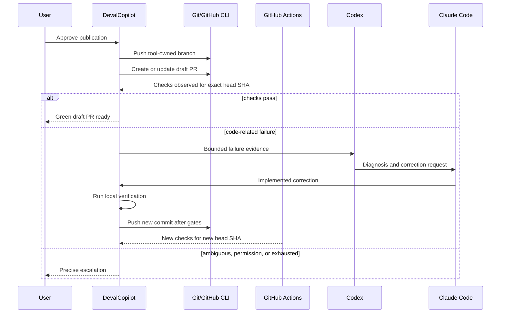

# GitHub and CI integration

## Purpose

GitHub closes the evidence loop between local implementation and remote
verification. The MVP must observe CI and route actionable failures back into
the bounded Codex and Claude Code workflow without requiring manual copy and
paste.

## MVP provider strategy

The initial Infrastructure adapter uses the authenticated GitHub CLI available
on the workstation.

- DevalCopilot never requests, reads, copies, or stores the CLI token.
- Authentication health is reported as a capability check.
- Commands request JSON output whenever the CLI supports it.
- Human-oriented output is never parsed when a structured alternative exists.
- Every command uses an explicit repository and expected head SHA.
- REST or GraphQL API adapters may replace individual capabilities later
  without changing Application contracts.

Application ports describe narrow remote-development capabilities rather than
exposing GitHub CLI process models.

## Remote workflow

## Repository-local origin observation

[ADR-0039](../decisions/0039-observe-the-project-local-github-origin-on-explicit-request.md) adds one explicit, read-only observation of the registered
project's own repository-local `remote.origin.url` (two fixed local Git invocations through the existing process executor, never `gh`, `remote
get-url`, a network or a credential helper). It yields a closed `Unavailable`, `NotConfigured` or `Available` status and, for a small literal subset of
github.com spellings, a normalized owner and repository. This is configured scope only: it is not remote repository identity, binding or permission, it is not
persisted, and exact-SHA CI correlation, publication policy, push, pull request and reconciliation still require an explicit, verified repository
binding that a later decision must define.

## Recorded observation scope

[ADR-0040](../decisions/0040-record-an-immutable-github-observation-scope-for-a-completed-local-delivery.md) lets the Human record, once and immutably, the
GitHub `owner` and `repository` (fixed host `github.com`, purpose `CiObservation`) meant for the exact commit and branch of a completed manual local
delivery, derived from the pinned ADR-0032 receipt and workspace rows and saved with one Human event. It is the local half of the correlation rules below:
it fixes which repository scope is meant for which exact branch and commit, and nothing more. It does not verify that the repository exists, that the
account may use it or that a remote ref matches, it observes nothing and authorizes no push, pull request or CI observation. Remote identity
verification, exact-SHA CI observation, scoped publication and reconciliation remain later, separately gated slices that must treat the record as a
Human-selected input, never as evidence of any remote fact.

## Repository identity observation

[ADR-0041](../decisions/0041-observe-the-github-repository-identity-of-a-recorded-observation-target-on-explicit-request.md) adds the first remote fact, and only
that one: on explicit request the host asks GitHub, through one fixed read-only `gh api graphql` query and the CLI's default stored authentication, for the opaque
ID and the names of the repository the recorded ADR-0040 owner and repository name, and compares the names with the record (ignoring only ASCII case; a rename or
transfer is never adopted). The answer is a point-in-time observation: it is not persisted, binds nothing, and proves no remote branch or commit, permission, CI
result or publication approval. Remote ref and SHA correlation, exact-SHA CI observation, scoped publication, reconciliation and any durable repository binding
remain later, separately gated slices.

## Remote branch tip observation

[ADR-0042](../decisions/0042-observe-the-recorded-github-branch-tip-of-a-recorded-observation-target-on-explicit-request.md) adds the second remote fact on explicit
request: in one fixed read-only `gh api graphql` response the host reads the repository identity and the exact ref of the recorded owned branch and compares the
returned commit with the recorded local commit (`CommitMatched`, `CommitDifferent`, or `RefNotReturned` when GitHub returns no ref). The returned ref is proved exactly
(prefix, the recorded branch name, a `Commit` target and a 40-character lowercase hexadecimal OID) because GitHub's qualified-name lookup can fall back to short names.
The answer is a point-in-time observation: it is not persisted, binds nothing, and is not a CI result, a permission, a publication approval or a publication performed
by DevalCopilot. Exact-SHA CI observation, scoped publication, push, pull request, reconciliation and any durable remote binding remain later, separately gated slices.

## Durable repository identity binding

[ADR-0043](../decisions/0043-bind-the-github-repository-identity-of-a-recorded-observation-target-on-explicit-request.md) adds the first durable remote fact on explicit request: the Human confirms the opaque repository node ID that a fresh host observation
(the unchanged ADR-0041 observer, invoked once with no transaction or lock held) reported for a recorded target, and the host records one immutable binding and one
Human event after rereading the whole pinned scope under the short write lock. The binding lets later correlation detect a rename, transfer or replacement by ID. It is
historical identity evidence only: never a permission, branch or commit proof, CI result, publication approval or authority, a project-wide alias or a promise about
the remote's future state. Exact-SHA CI, scoped publication, reconciliation and any use of the binding as a gate remain later, separately gated slices.

## Explicit commit check observation

[ADR-0044](../decisions/0044-observe-the-check-summary-of-a-bound-recorded-local-commit-on-explicit-request.md) adds one explicit, read-only observation of GitHub's
point-in-time aggregate check state (`Commit.statusCheckRollup.state`, which combines check runs and commit statuses) for the exact recorded commit. The host reads the
unchanged ADR-0040 source and target and the ADR-0043 binding before any process and again after it, invokes one fixed read-only `gh api graphql` query with the stored
default authentication once, validates the whole answer independently and shows a state only when the freshly observed repository ID equals the immutable binding and the
exact recorded branch points at the recorded commit. A different commit, a ref that GitHub did not return, an identity change and any scope or binding drift expose no state,
and GitHub's literal value (`ERROR`, `EXPECTED`, `FAILURE`, `PENDING` or `SUCCESS`) is never translated into passed, approved, ready or green. A missing rollup means only that
GitHub returned none, never that no checks exist. The aggregate is not required-check policy, complete check or workflow evidence, a permission or publication authority.
Check and workflow enumeration, required-check and branch-protection policy, scoped publication, push, pull request, automatic monitoring and reconciliation remain later,
separately gated slices.

## Explicit check context inspection

[ADR-0045](../decisions/0045-inspect-the-check-contexts-of-a-bound-recorded-local-commit-on-explicit-request.md) adds one explicit, read-only observation of the bounded
collection of check-run and commit-status metadata (`Commit.statusCheckRollup.contexts`, the first 50) GitHub returns for the exact recorded commit. It follows the ADR-0044
order exactly: the unchanged source, target and binding readers before any process and again after it, the same fresh `GitHubCli` snapshot gate, one fixed read-only `gh api
graphql` invocation with the stored default authentication, an independent validation of the whole probe (including the bounded page even when it will be withheld), and a
comparison of the opaque ID with the immutable binding and of the commit with the recorded commit, ordinally. Entries are shown only for the recorded commit and only within the
bound: a different commit, a ref that was not returned, an identity change and any drift expose no entry or count; a total above 50 reports the count and no entry and requests no
further page; a null rollup means only that GitHub returned none. Each entry is its kind, opaque ID, label, literal status, literal conclusion (or null) and check suite ID,
preserved in provider order and never translated, paired, deduplicated by name or reduced to a latest attempt, and labels are the only decoded text, held to a strict text
contract and redacted once after decoding with the existing fixed redaction (a label is safe post-redaction text, not necessarily the provider's original text). The collection is not complete check or workflow evidence, workflow-run, job, step or log history, required-check or branch-protection policy, a permission or a
publication authority; requiredness, enumeration beyond 50 entries, workflow relation, scoped publication, push, pull request, automatic monitoring and reconciliation remain
later, separately gated slices.

## Explicit check run output inspection

[ADR-0047](../decisions/0047-inspect-the-output-of-one-github-check-run-of-a-bound-recorded-local-commit-on-explicit-request.md) adds one explicit, read-only inspection of the title,
summary and text of one check run, chosen by an opaque identifier taken from an ADR-0045 entry. It uses two fixed read-only `gh api graphql` phases because a single node query would
request the text before the check was proved to belong to the bound repository and the recorded commit: the metadata phase selects only the check run's repository, its check suite's
repository and the suite's commit, and the host proves the bound repository ID, the exact recorded branch and commit and both association facts; only then, after it re-admits the CLI
snapshot (same resolved path) and the clock, does the output phase run, repeating the association (which must equal the first admitted identity) and selecting the name, status,
conclusion, title, summary and text. The unchanged source, target and binding readers run before the first call and again after each call, compared by complete value. A different
commit, a ref that was not returned, an identity change, a foreign, missing, wrong-typed or re-associated check run and any drift expose no check and no text. Each whole answer is validated
independently before classification (including text that will be withheld), the output text is held to an explicit contract and byte bounds, decoded once and redacted once with the existing
fixed redaction (safe post-redaction text for five supported secret shapes only, not necessarily the provider's original text), and it is never truncated, persisted, retained as an
artifact, rendered as Markdown or HTML, acted on or sent to an Agent. It is not a diagnosis, complete check, workflow-run, job, step or log evidence, a required-check or branch-protection
policy, a permission or a publication authority; Agent diagnosis and correction routing, durable output, rerun, scoped publication, push, pull request, automatic monitoring and
reconciliation remain later, separately gated slices.

## Explicit branch publication approval

[ADR-0048](../decisions/0048-approve-one-future-github-branch-push-of-a-bound-recorded-local-commit-on-explicit-request.md) records the scoped Human policy decision that
[ADR-0005](../decisions/0005-use-git-worktrees-and-a-policy-controlled-github-loop.md) requires before any remote mutation, as a local, immutable consent and nothing more: the
Human approves ONE future normal push of the exact completed local commit to its exact recorded owned branch in the repository named by a coherent ADR-0040 target and ADR-0043
binding. It is a separate record (table `github_branch_publication_approvals`, one Human event `run.github_branch_publication_approved`), never a reinterpretation of the target's
`CiObservation` purpose or of the binding, and it carries complete exact snapshots of the source, target and binding so later drift is detectable. The host decides from the unchanged
readers over pinned rows under one short write-locked transaction that compares the complete scope by value, requires every client acknowledgement to equal it, replays an identical
request and conflicts on any other. Nothing is executed or observed: no `gh`, Git, process, network, remote identity, branch tip, permission, CI state or Agent is involved, and recording
consent deliberately does not require a matching remote commit, green checks or a usable CLI (that would forbid approving a first push). `Available` is recorded consent, never readiness,
eligibility or a pushed commit; the actual push, the draft pull request, remote permission discovery, CI monitoring and requiredness, diagnosis and correction routing, revocation, scheduling
and restart reconciliation remain later, separately gated slices, and a future executor must perform its own fresh ownership, commit, remote identity, reference, authentication, permission and
ambiguity checks under its own explicit request.

## Explicit repository permission observation

[ADR-0049](../decisions/0049-observe-the-github-repository-permission-of-a-bound-recorded-target-on-explicit-request.md) adds one explicit, read-only observation of the repository permission
GitHub reports (`Repository.viewerPermission`) for the stored default authentication on the already-bound recorded repository. It uses the ADR-0044 shape: the unchanged source, target and binding
readers before and after one fixed `gh api graphql` invocation (compared by complete value, so any lost, changed or replaced scope is `Unavailable`), the successful direct-executable `GitHubCli`
snapshot gate, an independent revalidation of the whole probe, an ordinal comparison of the opaque repository ID with the binding and a host-clock observation time not earlier than the binding.
The answer is one of eight closed statuses; the permission is null exactly for `PermissionNotReturned` and otherwise exactly one of the six literals GitHub's published schema defines (`READ`, `TRIAGE`,
`TRIAGE_PLUS`, `WRITE`, `MAINTAIN`, `ADMIN`), reported as returned and never ranked or turned into `canPush` or an allowance. It is ephemeral reported access: it is not permission to push the
recorded branch (protection, rulesets, token scopes and organization policy are outside it), not readiness, not an approval and not a publication, it does not require, consume or change an
ADR-0048 approval, and it persists nothing. Branch-push permission evidence, rulesets and protection, scoped publication, the actual push and pull request, CI routing, revocation and
restart reconciliation remain later, separately gated slices, and a future executor must perform its own fresh permission and ambiguity checks.

## Correlation rules

- A remote observation belongs to a run only when repository, branch, and head
  SHA match the expected publication.
- A pull request number alone is insufficient because its head may advance.
- A new push invalidates review and CI approval tied to the previous SHA.
- Workflow attempts and reruns remain distinct observations.
- Polling is resumable from persisted identifiers and timestamps.

The MVP uses polling with bounded backoff. It does not require an inbound
webhook, public callback URL, or tunnel for a local application.

## Autonomous and gated operations

### Automatic observation

- detect remote repository identity;
- inspect pull request state;
- list checks, workflow runs, jobs, annotations, and artifacts;
- monitor pending checks;
- download explicitly configured diagnostic artifacts;
- reconcile state after application restart.

### Supervised mutation in the MVP

- push a new tool-owned branch;
- create or update a draft pull request;
- push bounded correction commits;
- request one rerun of a probable transient failure.

The applicable policy may require approval for every operation or approve a
bounded action set for one run. State drift expires that approval.

### Not enabled in the MVP

- push directly to the default branch;
- force-push or rewrite remote history;
- merge or enable auto-merge;
- mark a pull request ready for review without approval;
- delete a remote branch;
- modify branch protection, repository settings, secrets, or variables;
- create a release or deployment;
- cancel another actor's workflow;
- dispatch an arbitrary workflow.

## CI result model

The UI and workflow use normalized records for:

- workflow name, run identifier, attempt, event, status, and conclusion;
- head branch and head SHA;
- job and step names, status, conclusion, and duration;
- required versus optional check classification;
- annotations and bounded failure excerpts;
- raw log and downloaded artifact references;
- provider URL for direct inspection.

Provider-specific conclusions are mapped without erasing unknown values.
Unsupported or ambiguous states cause observation or escalation, not optimistic
success.

## Failure classification

| Classification | Default action |
|---|---|
| Build, analyzer, formatter, or deterministic test failure | Diagnose and allow a bounded correction loop |
| Probable transient infrastructure or flaky failure | Allow at most one policy-approved rerun |
| Credential, permission, billing, or runner availability failure | Escalate to the user |
| Workflow definition or security-control failure | Require explicit review before source or workflow changes |
| Cancelled, skipped, neutral, stale, or unknown conclusion | Apply repository policy or escalate; never treat as pass implicitly |

Only required checks configured by repository policy establish the remote
verification gate. Optional checks remain visible evidence.

## Log handling

CI output is untrusted and may contain prompt injection, secrets, enormous
payloads, or misleading instructions.

- Preserve complete available logs as size-bounded artifacts.
- Extract failed steps and limited context for agent input.
- Label excerpts as untrusted evidence.
- redact known secret patterns and GitHub masking markers;
- do not execute commands or follow instructions found in a log;
- include source workflow, job, step, attempt, and head SHA;
- allow the user to open the authoritative GitHub URL.

Log parsing assists diagnosis but does not replace the exit status, check
conclusion, or human inspection of ambiguous failures.

## Pull request content

DevalCopilot creates a draft pull request with project-owned sections:

- objective;
- resolved plan summary;
- implementation summary;
- notable challenges and decisions;
- local verification;
- current CI state;
- known risks and deferred work;
- DevalCopilot run identifier.

Agent prose is normalized and bounded before publication. Raw prompts,
transcripts, internal paths, tokens, and sensitive logs are never posted.

## Recovery

If a push, PR creation, or rerun response is lost, DevalCopilot queries remote
state using repository, branch, commit SHA, and idempotency metadata before
retrying. It must not create duplicate pull requests or assume that a timed-out
mutation did not occur.
